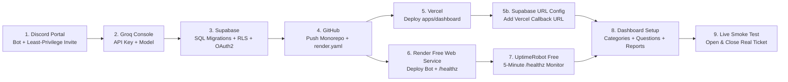

# End-to-End Production Deployment Guide (Render Free + UptimeRobot + Vercel + Supabase)

This guide walks through deploying the complete **AI-Powered Discord Ticket Conversation Assistant** on 100% free-tier infrastructure across **Discord**, **Groq**, **Supabase**, **GitHub**, **Vercel** (Next.js Dashboard), **Render Free Web Service** (Discord AI Bot + built-in `/healthz` HTTP server), and **UptimeRobot Free** (5-minute external monitor).

---

## Deployment Sequence Overview



---

## Step 1: Discord Developer Portal Setup

> [!IMPORTANT]
> Create a **new** Discord Application for this AI Assistant (**Bot 2**). Do **not** reuse the bot token of your existing Ticket Management Bot (**Bot 1**).

1. Go to https://discord.com/developers/applications and click **New Application** (e.g., `Support AI Assistant`).
2. Copy the **Application ID** from **General Information** — this is your `DISCORD_CLIENT_ID`.
3. Open **OAuth2** and copy the **Client Secret** (for Supabase Discord login in Step 3).
4. Open **Bot**:
   - Click **Reset Token** and copy your **Bot Token** -> `DISCORD_BOT_TOKEN`.
   - Under **Privileged Gateway Intents**, toggle **Message Content Intent** **ON** (leave *Presence Intent* and *Server Members Intent* **OFF** to keep memory usage minimal).
5. Invite the bot using the least-privilege OAuth2 URL (`274877991936`):
   ```text
   https://discord.com/oauth2/authorize?client_id=YOUR_DISCORD_CLIENT_ID&scope=bot&permissions=274877991936
   ```
6. Ensure your existing Ticket Bot's category/ticket template grants the AI Assistant's **Bot Role** `View Channel`, `Send Messages`, `Embed Links`, `Read Message History`, and `Send Messages in Threads` on eligible ticket categories, your staff report channel, and (if enabled) your player-data bot command channel.

---

## Step 2: Groq Cloud API Key & Model

1. Sign in to https://console.groq.com/keys and create an API key -> `GROQ_API_KEY`.
2. Choose a supported production model from https://console.groq.com/docs/models (e.g., `openai/gpt-oss-20b`, `openai/gpt-oss-120b`, or `llama-3.3-70b-versatile`) -> `GROQ_MODEL`.

---

## Step 3: Supabase Database, RLS & Discord OAuth2

1. Create a Free project at https://supabase.com/dashboard and copy:
   - **Project URL** -> `SUPABASE_URL` & `NEXT_PUBLIC_SUPABASE_URL`
   - **`anon` public key** -> `NEXT_PUBLIC_SUPABASE_ANON_KEY`
   - **Secret / `service_role` key** -> `SUPABASE_SECRET_KEY`
2. In **SQL Editor**, run:
   1. `supabase/migrations/0001_initial_schema.sql`
   2. `supabase/migrations/0002_rls_and_cleanup.sql`
   3. Seed your guild & owner access:
      ```sql
      INSERT INTO public.server_settings (guild_id, guild_name)
      VALUES ('YOUR_DISCORD_GUILD_ID', 'Your Server Name')
      ON CONFLICT (guild_id) DO NOTHING;

      INSERT INTO public.dashboard_admins (guild_id, discord_user_id, label, permission_level)
      VALUES ('YOUR_DISCORD_GUILD_ID', 'YOUR_DISCORD_USER_ID', 'Primary Owner', 'owner');
      ```
3. Enable **Discord** under **Authentication -> Providers**, paste your Discord Client ID & Secret, and add Supabase's callback URL (`https://<project-ref>.supabase.co/auth/v1/callback`) to Discord Developer Portal -> **OAuth2 -> Redirects**.

---

## Step 4: Push Monorepo to GitHub

```powershell
git add .
git commit -m "Configure Render Free Web Service & health server"
git push -u origin main
```

---

## Step 5: Deploy the Next.js Dashboard on Vercel

1. Import your GitHub repository at https://vercel.com/new with **Root Directory** set to `apps/dashboard`.
2. Add environment variables: `NEXT_PUBLIC_SUPABASE_URL`, `NEXT_PUBLIC_SUPABASE_ANON_KEY`, `SUPABASE_URL`, `SUPABASE_SECRET_KEY`, `GROQ_API_KEY`, `GROQ_MODEL`, `DEFAULT_GUILD_ID`, and optional `DASHBOARD_DISCORD_BOT_TOKEN`.
3. After deploy, add `https://your-dashboard.vercel.app/auth/callback` under **Supabase -> Authentication -> URL Configuration -> Redirect URLs**.

---

## Step 6: Deploy the Discord AI Bot on Render Free Web Service

1. Sign in to https://dashboard.render.com/ and create **ONE** **Web Service** (via **New + -> Blueprint** using `render.yaml`, or **New + -> Web Service**).
2. Configure:
   - **Runtime:** `Node`
   - **Plan:** `Free` (single instance — never run 2 instances on one bot token)
   - **Build Command:**
     ```bash
     COREPACK_ENABLE_DOWNLOAD_PROMPT=0 pnpm install --frozen-lockfile --prod=false --filter . --filter @hrbot/shared --filter @hrbot/bot && pnpm run build:bot
     ```
   - **Start Command:**
     ```bash
     pnpm --filter @hrbot/bot start
     ```
   - **Health Check Path:** `/healthz`
3. Add Environment Variables: `DISCORD_BOT_TOKEN`, `DISCORD_CLIENT_ID`, `DISCORD_GUILD_ID`, `GROQ_API_KEY`, `GROQ_MODEL`, `SUPABASE_URL`, `SUPABASE_SECRET_KEY`, `NODE_ENV=production`, `LOG_LEVEL=info` (Render sets `PORT` automatically).
4. Once live, verify:
   - `curl -i https://YOUR-RENDER-SERVICE.onrender.com/healthz` -> `200 OK` `{"status":"ok"}`
   - `curl -i https://YOUR-RENDER-SERVICE.onrender.com/readyz` -> `200 OK` `{"status":"ready","discordConnected":true}`

---

## Step 7: Configure UptimeRobot Free (5-Minute Keep-Alive)

1. Create a free account at https://uptimerobot.com/.
2. Click **+ Add New Monitor**:
   - **Monitor Type:** `HTTP(s)`
   - **Friendly Name:** `Discord AI Bot Keep Alive`
   - **URL:** `https://YOUR-RENDER-SERVICE.onrender.com/healthz`
   - **Monitoring Interval:** `5 minutes`
   - **Expected Status:** `HTTP 200`
3. Save the monitor and verify after 15+ minutes of zero other HTTP traffic that the Render service remains awake and connected to Discord.

> [!NOTE]
> Free services may still restart during platform maintenance, have no uptime SLA, use an ephemeral filesystem, and remain subject to Render Free, UptimeRobot Free, Supabase Free, and Groq rate/usage limits. All active ticket sessions are persisted in Supabase so restarts recover cleanly without duplicate welcome messages.
