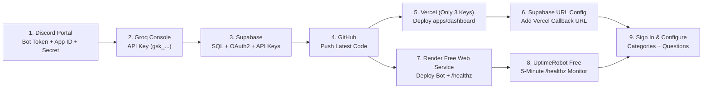

# Complete End-to-End Deployment Guide (Render Free + Vercel + Supabase + Groq + UptimeRobot)

This guide covers every step in exact order to deploy both the **Discord AI Ticket Assistant (`@hrbot/bot`)** on **Render Free** and the **Moderator Dashboard (`@hrbot/dashboard`)** on **Vercel Hobby**, including **exact click-by-click locations** for every environment variable.

---

## Architecture Overview



---

## Step 1: Discord Developer Portal & Discord Server IDs

1. Open https://discord.com/developers/applications and select your **AI Assistant** application (**Bot 2** — never reuse your existing Ticket Bot's token).
2. **General Information tab:**
   - Copy **Application ID** (17–20 digits) -> save for `DISCORD_CLIENT_ID` (and Supabase Discord OAuth).
3. **OAuth2 tab:**
   - Under *Client information*, copy **Client Secret** (click *Reset Secret* if you don't have it) -> save for Supabase Discord OAuth in Step 3.3.
4. **Bot tab:**
   - Click **Reset Token** / **Copy** -> save for `DISCORD_BOT_TOKEN`.
   - Scroll down to **Privileged Gateway Intents**:
     - Toggle **Message Content Intent** **ON**.
     - Leave *Presence Intent* and *Server Members Intent* **OFF** (minimizes RAM on Render Free).
   - Click **Save Changes**.
5. **Invite Bot to Your Discord Server (Least-Privilege Only):**
   Open this URL in your browser (replace `YOUR_DISCORD_CLIENT_ID`):
   ```text
   https://discord.com/oauth2/authorize?client_id=YOUR_DISCORD_CLIENT_ID&scope=bot&permissions=274877991936
   ```
   - Ensure your existing Ticket Bot grants the AI Assistant's **Bot Role** `View Channel`, `Send Messages`, `Embed Links`, `Read Message History`, and `Send Messages in Threads` on your ticket categories and staff report channel.
6. **Copy Your 2 Discord IDs Inside Discord:**
   - Open Discord -> **User Settings -> Advanced -> Developer Mode** = **ON**.
   - Right-click your **Discord Server icon** -> click **Copy Server ID** -> save for `DISCORD_GUILD_ID`.
   - Right-click **your own Discord profile/avatar** -> click **Copy User ID** -> save for `YOUR_DISCORD_USER_ID` (Step 3.2).

---

## Step 2: Groq Console API Key

1. Open https://console.groq.com/keys and click **Create API Key**.
2. Copy the key (starts with `gsk_...`) -> save for `GROQ_API_KEY`.

---

## Step 3: Supabase Database, API Keys & Discord OAuth2

### 3.1 Locate Your 3 Supabase Values
Open https://supabase.com/dashboard -> select your project -> click **Project Settings** (gear icon at the bottom-left):

1. **`SUPABASE_URL`:**
   - Click **Project Settings -> Data API** -> under **Project URL**, click **Copy**.
   - Must look like: `https://abcdefghijklm.supabase.co` *(never starts with `sb_`)*.
2. **`SUPABASE_ANON_KEY`:**
   - Click **Project Settings -> API Keys** -> under **Publishable key**, click **Copy** *(or `anon` `public` under Legacy keys)*.
   - Must look like: `sb_publishable_...` *(or `eyJ...`)*.
3. **`SUPABASE_SECRET_KEY`:**
   - Click **Project Settings -> API Keys** -> under **Secret keys**, click **Add new secret key** (if rotating, delete any previously exposed key first) -> click **Copy** *(or `service_role` `secret` under Legacy keys)*.
   - Must look like: `sb_secret_...` *(or `eyJ...`)*.

### 3.2 Run SQL Migrations & Authorize Your Discord Account
Open **SQL Editor -> New Query** in Supabase and run these **3 scripts in order**:

1. Paste all of `supabase/migrations/0001_initial_schema.sql` -> click **Run**.
2. Paste all of `supabase/migrations/0002_rls_and_cleanup.sql` -> click **Run**.
3. Run this query (replace `YOUR_DISCORD_GUILD_ID` and `YOUR_DISCORD_USER_ID` with the two 18-digit numbers from Step 1.6):
   ```sql
   INSERT INTO public.server_settings (guild_id, guild_name)
   VALUES ('YOUR_DISCORD_GUILD_ID', 'My Discord Server')
   ON CONFLICT (guild_id) DO NOTHING;

   INSERT INTO public.dashboard_admins (guild_id, discord_user_id, label, permission_level)
   VALUES ('YOUR_DISCORD_GUILD_ID', 'YOUR_DISCORD_USER_ID', 'Owner', 'owner');
   ```

### 3.3 Enable Discord OAuth2 Provider in Supabase
1. In Supabase, go to **Authentication -> Providers -> Discord**.
2. Toggle **Enable Sign in with Discord** **ON**.
3. Paste:
   - **Client ID:** Your `DISCORD_CLIENT_ID` (from Step 1.2)
   - **Client Secret:** Your Discord OAuth2 **Client Secret** (from Step 1.3)
4. Copy the **Callback URL (for OAuth)** shown by Supabase:
   ```text
   https://<your-project-id>.supabase.co/auth/v1/callback
   ```
5. Click **Save** in Supabase.
6. Go back to **Discord Developer Portal -> Your App -> OAuth2 -> Redirects**:
   - Click **Add Redirect**, paste **`https://<your-project-id>.supabase.co/auth/v1/callback`** *(Supabase's URL — NOT Vercel's!)*, and click **Save Changes**.

---

## Step 4: Push Code to GitHub

```powershell
git add .
git commit -m "Update deployment config, Render build command, and server-side Discord OAuth2"
git push
```

---

## Step 5: Deploy Website Dashboard on Vercel (Exact 3 Keys)

1. Open https://vercel.com/dashboard -> select your dashboard project -> **Settings -> General**:
   - Confirm **Root Directory** is set to `apps/dashboard`.
2. Go to **Settings -> Environment Variables**:
   - Delete any old/extra variables so nothing conflicts.
   - Add **only these 3 variables** (all 3 come from Supabase):

   | Key Name on Vercel | Exact Where to Copy From | Example Format |
   |---|---|---|
   | `SUPABASE_URL` | **Supabase -> Project Settings -> Data API -> Project URL** | `https://abcdefghijklm.supabase.co` |
   | `SUPABASE_ANON_KEY` | **Supabase -> Project Settings -> API Keys -> Publishable key** | `sb_publishable_...` |
   | `SUPABASE_SECRET_KEY` | **Supabase -> Project Settings -> API Keys -> Secret keys** | `sb_secret_...` |

3. Go to **Deployments -> click `...` on the latest deployment -> Redeploy** and copy your live Vercel URL (e.g. `https://your-dashboard.vercel.app`).

---

## Step 6: Add Vercel URL to Supabase Auth Redirects

1. Open **Supabase -> Authentication -> URL Configuration**:
   - **Site URL:** `https://your-dashboard.vercel.app` *(no trailing slash)*
   - **Redirect URLs:** Click **Add URL** and enter:
     ```text
     https://your-dashboard.vercel.app/auth/callback
     ```
2. Click **Save**.
3. Test signing in at `https://your-dashboard.vercel.app/login`!

---

## Step 7: Deploy Discord AI Bot on Render Free Web Service (Exact Keys)

### 7.1 Service & Build Settings
Open https://dashboard.render.com/ -> your **Web Service** (`discord-ticket-ai-bot`) -> **Settings**:

- **Runtime:** `Node`
- **Branch:** `main`
- **Root Directory:** *(leave completely blank)*
- **Instance Type:** `Free`
- **Build Command:**
  ```bash
  COREPACK_ENABLE_DOWNLOAD_PROMPT=0 pnpm install --frozen-lockfile --prod=false --filter . --filter @hrbot/shared --filter @hrbot/bot && pnpm run build:bot
  ```
- **Start Command:**
  ```bash
  pnpm --filter @hrbot/bot start
  ```
- **Health Check Path (under Advanced):**
  ```text
  /healthz
  ```

### 7.2 Exact Environment Variables to Add on Render
Go to **Render -> Your Web Service -> Environment** and add these **10 rows** *(do **NOT** add `PORT` — Render injects `PORT` automatically!)*:

#### Part A — 6 Credentials & IDs You Copy From Dashboards:

| Key Name on Render | Exact Where to Copy From | What Value Must Look Like |
|---|---|---|
| `DISCORD_BOT_TOKEN` | **Discord Developer Portal -> Your App -> Bot -> Token** *(NOT Client Secret!)* | Long 3-part token string (`MT...`) |
| `DISCORD_CLIENT_ID` | **Discord Developer Portal -> Your App -> General Information -> Application ID** | 17–20 digits (`123456789012345678`) |
| `DISCORD_GUILD_ID` | **Discord App -> Right-click your Server icon -> Copy Server ID** | 17–20 digits (`987654321098765432`) |
| `GROQ_API_KEY` | **https://console.groq.com/keys -> Create API Key** | Starts with `gsk_...` |
| `SUPABASE_URL` | **Supabase -> Project Settings -> Data API -> Project URL** *(same as Vercel)* | `https://abcdefghijklm.supabase.co` |
| `SUPABASE_SECRET_KEY` | **Supabase -> Project Settings -> API Keys -> Secret keys** *(same as Vercel)* | `sb_secret_...` |

#### Part B — 5 Plain Text Runtime Settings You Type Directly:

| Key Name on Render | Exact Value to Type | Purpose |
|---|---|---|
| `GROQ_MODEL` | `openai/gpt-oss-120b` | Recommended flagship Groq Production model (strict `json_schema` + 200k TPD free tier; can also be switched live in Dashboard) |
| `NODE_ENV` | `production` | Runs Node.js in production mode |
| `NODE_OPTIONS` | `--dns-result-order=ipv4first --no-network-family-autoselection` | Forces IPv4 on Render so Node 22/24 `fetch()` connects to Supabase without IPv6 `fetch failed` timeouts |
| `COREPACK_ENABLE_DOWNLOAD_PROMPT` | `0` | Prevents Corepack from pausing for `[Y/n]` download confirmation |
| `LOG_LEVEL` | `info` | Structured JSON log verbosity (`debug`, `info`, `warn`, `error`) |

### 7.3 Deploy & Test Endpoints
1. Click **Save Changes** (or **Manual Deploy -> Deploy latest commit**).
2. Wait until Render status turns **Live**, then copy your Render URL (`https://YOUR-RENDER-SERVICE.onrender.com`).
3. Verify in your browser or terminal:
   - `https://YOUR-RENDER-SERVICE.onrender.com/healthz` -> `{"status":"ok"}` (`HTTP 200`)
   - `https://YOUR-RENDER-SERVICE.onrender.com/readyz` -> `{"status":"ready","discordConnected":true}` (`HTTP 200`)

---

## Step 8: Keep Render Awake with UptimeRobot Free

1. Create a free account at https://uptimerobot.com/ and click **+ Add New Monitor**:

   | Setting | Value |
   |---|---|
   | **Monitor Type** | `HTTP(s)` |
   | **Friendly Name** | `Discord AI Bot Keep Alive` |
   | **URL (or IP)** | `https://YOUR-RENDER-SERVICE.onrender.com/healthz` |
   | **Monitoring Interval** | `5 minutes` |
   | **Expected Status** | `HTTP 200` |

2. Click **Create Monitor**.

---

## Step 9: Configure Server Details, 1-Line DOT Commands & Categories in Dashboard

1. Log in at `https://your-dashboard.vercel.app/login` and verify **Bot Worker Online** is green on **Overview**.
2. **Server Info & Persona (`/server-info`):**
   - Set your **Server / Clan Family Name** (e.g. `Boom House`) and **Bot Persona Name** (e.g. `Duke The Recruiter`).
   - Keep **Tag Opener on 1st Message**, **Ignore Private Threads**, and **Humanize Replies** **ON**.
   - Fill in the **4 Server & Clan Details** boxes (or click **Fill Sample Clan Template** and customize your clan requirements, rules, and expected leader response time) -> click **Save & Publish Server Info**.
3. **DOT Commands (`/player-integration`):**
   - Toggle **Enabled** **ON**.
   - In **1. Your DOT Command (1 Line)**, type just one line: e.g. `.p {tag}` or `.player {tag}`.
   - Paste your **Stats Bot's Discord User ID** (e.g. ClashPerk / ClashKing User ID), choose **Inside the Ticket Channel** (or a Dedicated Bot Channel), toggle your category **ON**, and click **Save & Publish DOT Command Setup**.
4. **Category Management (`/categories`) & Question Builder (`/questions`):**
   - Paste your Discord Ticket Category ID, toggle **Enable AI in Category** **ON** -> **Publish Category Version**.
   - Add your intake questions (e.g. `player_tag`) in **Question Builder** -> **Publish Questionnaire**.
5. **Report Settings (`/reports`):** Paste your pre-existing **Staff Report Channel ID** -> click **Publish**.

---

## Common Mistakes & Instant Fixes

| Symptom | Cause & Fix |
|---|---|
| Browser goes to `https://sb_secret_....supabase.co` | You pasted `sb_secret_...` into `SUPABASE_URL`. Replace `SUPABASE_URL` with `https://<project-id>.supabase.co` from **Supabase -> Project Settings -> Data API -> Project URL** and rotate the leaked secret key. |
| Discord screen says `Invalid OAuth2 redirect_uri` | In **Discord Developer Portal -> OAuth2 -> Redirects**, paste `https://<project-id>.supabase.co/auth/v1/callback` (Supabase's callback URL, *not* Vercel's URL). |
| `/login` says `your account is not yet in dashboard_admins` | Copy the pre-filled 2-line `INSERT INTO public.dashboard_admins ...` SQL box displayed right on `/login` and run it in **Supabase -> SQL Editor**. |
| Render build fails with `EROFS: read-only file system, unlink '/usr/bin/pnpm'` | Remove `corepack enable &&` from Render's Build Command and use the exact Build Command in Step 7.1. |
| Render bot fails to log into Discord (`TokenInvalid`) | Make sure `DISCORD_BOT_TOKEN` came from **Discord Developer Portal -> Bot -> Reset/Copy Token**, *not* OAuth2 Client Secret. |
