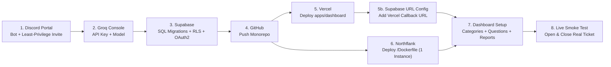

# End-to-End Production Deployment Guide

This guide walks through deploying the complete **AI-Powered Discord Ticket Conversation Assistant** from scratch across **Discord**, **Groq**, **Supabase**, **GitHub**, **Vercel** (Next.js Dashboard), and **Northflank** (Persistent Docker Bot).

---

## Deployment Sequence Overview



---

## Step 1: Discord Developer Portal Setup

> [!IMPORTANT]
> Create a **new** Discord Application for this AI Assistant (**Bot 2**). Do **not** reuse the bot token of your existing Ticket Management Bot (**Bot 1**).

1. Go to https://discord.com/developers/applications and click **New Application** (e.g., `Support AI Assistant`).
2. Copy the **Application ID** from **General Information** — this is your `DISCORD_CLIENT_ID`.
3. Open **OAuth2**:
   - Copy the **Client Secret** (save this for Supabase Discord login in Step 3).
4. Open **Bot**:
   - Click **Reset Token** and copy your **Bot Token** — this is your `DISCORD_BOT_TOKEN`.
   - Scroll to **Privileged Gateway Intents**:
     - Toggle **Message Content Intent** **ON**.
     - Leave *Presence Intent* and *Server Members Intent* **OFF**.
   - Click **Save Changes**.
5. Invite the bot to your Discord server using the **exact least-privilege OAuth2 URL** (replace `YOUR_DISCORD_CLIENT_ID`):
   ```text
   https://discord.com/oauth2/authorize?client_id=YOUR_DISCORD_CLIENT_ID&scope=bot&permissions=274877991936
   ```
   - Bitfield `274877991936` grants **only**: `View Channel`, `Send Messages`, `Embed Links`, `Read Message History`, and `Send Messages in Threads`.
   - It intentionally excludes `Administrator`, `Manage Channels`, `Manage Threads`, and `Create Public/Private Threads`.
6. **Grant Channel Access for Private Tickets:**
   - Because ticket channels are private to the player and staff, make sure your existing Ticket Bot's category/ticket template grants the new AI Assistant's **Bot Role** permission to **View Channel**, **Send Messages**, **Embed Links**, **Read Message History**, and **Send Messages in Threads** on:
     - Eligible Ticket Categories (e.g., *Player Support*)
     - Your existing Staff-Only Report Channel
     - Your existing Player-Data Bot Command Channel (if using player lookups)
7. In Discord, enable **User Settings -> Advanced -> Developer Mode** and copy:
   - Your **Server ID** (right-click server icon -> *Copy Server ID*) -> `DISCORD_GUILD_ID` / `DEFAULT_GUILD_ID`
   - Your **Discord User ID** (right-click your profile -> *Copy User ID*) -> for seeding initial owner access
   - Your **Existing Ticket Bot's User ID** (right-click your ticket bot -> *Copy User ID*)

---

## Step 2: Groq Cloud API Key & Model

1. Sign in to https://console.groq.com/keys and click **Create API Key**.
2. Copy the key (`gsk_...`) — this is your `GROQ_API_KEY`.
3. Check https://console.groq.com/docs/models and pick your initial `GROQ_MODEL`:
   - `openai/gpt-oss-20b` *(Recommended fast production default; supports strict `json_schema` constrained decoding + tool calls)*
   - `openai/gpt-oss-120b` *(Higher reasoning capacity; supports strict `json_schema`)*
   - `llama-3.3-70b-versatile` or `llama-3.1-8b-instant` *(Uses `json_object` mode + Zod validation)*

---

## Step 3: Supabase Database, RLS & Discord OAuth2

### 3.1 Create Project & Copy Keys
1. Go to https://supabase.com/dashboard and click **New Project**.
2. Once provisioned, open **Project Settings -> API** and record:
   - **Project URL** -> `SUPABASE_URL` and `NEXT_PUBLIC_SUPABASE_URL`
   - **`anon` `public` key** -> `NEXT_PUBLIC_SUPABASE_ANON_KEY`
   - **`service_role` `secret` key** -> `SUPABASE_SERVICE_ROLE_KEY` *(Server-side only — never expose in `NEXT_PUBLIC_`!)*

### 3.2 Run SQL Migrations & Seed Owner Access
Open **SQL Editor -> New Query** in Supabase and run these 3 scripts in order:

1. Paste the entire contents of `supabase/migrations/0001_initial_schema.sql` and click **Run**.
2. Paste the entire contents of `supabase/migrations/0002_rls_and_cleanup.sql` and click **Run**.
3. Run the bootstrap query below (replacing `YOUR_DISCORD_GUILD_ID` and `YOUR_DISCORD_USER_ID` with the Snowflake IDs copied in Step 1):
   ```sql
   INSERT INTO public.server_settings (guild_id, guild_name)
   VALUES ('YOUR_DISCORD_GUILD_ID', 'Your Server Name')
   ON CONFLICT (guild_id) DO NOTHING;

   INSERT INTO public.dashboard_admins (guild_id, discord_user_id, label, permission_level)
   VALUES ('YOUR_DISCORD_GUILD_ID', 'YOUR_DISCORD_USER_ID', 'Primary Owner', 'owner');
   ```

### 3.3 Enable Discord OAuth2 Provider
1. In Supabase, go to **Authentication -> Providers -> Discord**.
2. Toggle **Enable Sign in with Discord** **ON**.
3. Paste the **Client ID** (`DISCORD_CLIENT_ID`) and **Client Secret** from Step 1.
4. Copy the **Callback URL (for OAuth)** displayed by Supabase (looks like `https://<project-ref>.supabase.co/auth/v1/callback`).
5. Click **Save** in Supabase.
6. Go back to **Discord Developer Portal -> Your App -> OAuth2 -> Redirects**, click **Add Redirect**, paste `https://<project-ref>.supabase.co/auth/v1/callback`, and click **Save Changes**.

---

## Step 4: Push Repository to GitHub

1. Create a new **Private** repository on GitHub (e.g., `discord-ticket-ai`).
2. From `d:\hrbot`, commit and push:
   ```powershell
   git add .
   git commit -m "Initial release: Discord Ticket AI Conversation Assistant"
   git remote add origin https://github.com/YOUR_GITHUB_USERNAME/discord-ticket-ai.git
   git push -u origin main
   ```
   *(Verify `.env` is never committed — `.gitignore` excludes `.env*` automatically.)*

---

## Step 5: Deploy the Next.js Dashboard on Vercel

> [!WARNING]
> Deploy **only** `apps/dashboard` to Vercel. Never deploy the persistent Discord Gateway bot on Vercel Serverless Functions.

1. Go to https://vercel.com/new and **Import** your `discord-ticket-ai` GitHub repository.
2. Under **Configure Project**:
   - **Framework Preset:** `Next.js`
   - **Root Directory:** Click **Edit** and enter `apps/dashboard` *(Critical!)*
   - *(Build & Install commands are automatically loaded from `apps/dashboard/vercel.json`.)*
3. Expand **Environment Variables** and add:

   | Variable Name | Value | Scope |
   |---|---|---|
   | `NEXT_PUBLIC_SUPABASE_URL` | `https://<project-ref>.supabase.co` | Production, Preview |
   | `NEXT_PUBLIC_SUPABASE_ANON_KEY` | Your Supabase `anon` key | Production, Preview |
   | `SUPABASE_URL` | `https://<project-ref>.supabase.co` | Production, Preview |
   | `SUPABASE_SERVICE_ROLE_KEY` | Your Supabase `service_role` secret key | Production, Preview |
   | `GROQ_API_KEY` | `gsk_...` | Production, Preview |
   | `GROQ_MODEL` | `openai/gpt-oss-20b` | Production, Preview |
   | `DEFAULT_GUILD_ID` | Your Discord Server ID (`17-20` digits) | Production, Preview |
   | `DASHBOARD_DISCORD_BOT_TOKEN` | *(Optional)* Your `DISCORD_BOT_TOKEN` if using Discord Role ID allowlists | Production, Preview |

4. Click **Deploy** and wait ~60 seconds for your production URL (e.g., `https://your-dashboard.vercel.app`).
5. **Finalize Supabase OAuth Redirects:**
   - Open **Supabase -> Authentication -> URL Configuration**:
     - Set **Site URL** to `https://your-dashboard.vercel.app`
     - Under **Redirect URLs**, add:
       - `https://your-dashboard.vercel.app/auth/callback`
       - `http://localhost:3000/auth/callback` *(optional for local testing)*
     - Click **Save**.

---

## Step 6: Deploy the Persistent Discord Bot on Northflank (Docker)

> [!CAUTION]
> Keep **Instances = `1`** and stay within your Northflank Sandbox / approved plan allowance. Running more than 1 container instance against the same non-sharded Discord Bot Token will cause duplicate Gateway connections!

1. Sign in to https://app.northflank.com and create a **Project** (select the free **Sandbox** tier if applicable).
2. Connect your GitHub account under **Account Settings -> Git Integrations**.
3. Inside your Northflank project, click **Create Service -> Combined Service**:
   - **Service Name:** `discord-ticket-ai-bot`
   - **Repository:** Select `discord-ticket-ai`, branch `main`
   - **Build Options:** Select **Dockerfile**
     - **Dockerfile Path:** `/Dockerfile`
     - **Build Context:** `/`
   - **Resources / Compute Plan:** Choose your Sandbox allowance plan (e.g., `nf-compute-10`) and set **Instances** to **`1`**.
   - **Networking / Ports:** Leave **Ports empty** (do **not** expose any public HTTP port; the bot connects outbound to Discord Gateway, Groq, and Supabase).
4. Under **Environment Variables -> Runtime Variables / Secret Files**, add:

   | Variable Name | Value |
   |---|---|
   | `DISCORD_BOT_TOKEN` | Your Discord Bot Token |
   | `DISCORD_CLIENT_ID` | Your Discord Application ID |
   | `DISCORD_GUILD_ID` | Your Discord Server ID |
   | `GROQ_API_KEY` | `gsk_...` |
   | `GROQ_MODEL` | `openai/gpt-oss-20b` |
   | `SUPABASE_URL` | `https://<project-ref>.supabase.co` |
   | `SUPABASE_SERVICE_ROLE_KEY` | Your Supabase `service_role` secret key |
   | `CLOSURE_RECONCILE_INTERVAL_MS` | `60000` |
   | `BOT_HEARTBEAT_INTERVAL_MS` | `30000` |
   | `LOG_LEVEL` | `info` |

5. Click **Create Service**.
6. Watch the **Builds** tab complete, then open the **Containers / Logs** tab and confirm you see:
   ```json
   {"level":"info","component":"ticket-ai-bot","msg":"Connected to Discord Gateway as ticket conversation assistant"}
   ```

---

## Step 7: Initial Configuration in the Live Dashboard

1. Visit `https://your-dashboard.vercel.app/login` and click **Sign in with Discord**.
2. On **Overview**, verify the green **Bot Worker Online** badge appears (updated every 30s via heartbeat).
3. Go to **AI Settings**:
   - Under **Existing Ticket Provider Bot User IDs**, paste your existing Ticket Bot's Discord User ID (e.g. `557628352828014614`).
   - Confirm **Ticket Channel Name Prefixes** (e.g. `ticket-, support-`) and **Thread Closure Detection Policy** (`locked_only` recommended).
   - Click **Publish AI & Ticket Detection Settings**.
4. Go to **Report Settings**:
   - Paste your pre-existing **Staff-Only Report Channel ID** and **Staff Role IDs**.
   - Click **Publish Report Settings**.
5. *(Optional)* Go to **Player Integration**:
   - Toggle **ON**, enter your existing Player-Data Bot's Discord User ID, command prefix (e.g. `.`), and dedicated pre-existing command channel ID.
   - Verify your command templates in the **Test Integration & Parser** panel, then click **Publish**.
6. Go to **Category Management**:
   - Under *Add Existing Discord Category*, paste the Discord Category ID where your existing ticket bot creates tickets (e.g. *Player Support*), enter its name, click **Add Category**.
   - Toggle **Enable AI in Category** **ON**, customize your welcome message if desired, and click **Publish Category Version**.
7. Go to **Question Builder**:
   - Select your category, add your intake questions (e.g., `player_tag`, `clan_name`, `issue`), test them in the **Live Questionnaire Preview**, and click **Publish Questionnaire**.

---

## Step 8: End-to-End Smoke Test & Troubleshooting

### Smoke Test Checklist
1. Click **Open Ticket** on your **existing Ticket Bot** inside an enabled category.
2. Confirm our AI Assistant sends the welcome introduction **once** and asks the first question.
3. Reply naturally (e.g., *"My tag is #ABC123 and I'm in BOOM clan"*); confirm both answers are extracted without repeating answered questions.
4. Answer the remaining question; confirm the **Moderator Investigation Report** posts in your pre-existing Staff Report Channel.
5. Close/delete the ticket using your **existing Ticket Bot**.
6. Open Supabase **Table Editor** and confirm `ticket_sessions`, `ticket_messages`, `ticket_answers`, `player_lookups`, and `staff_reports` have **`0` rows** for that closed ticket, while `server_settings` and `ticket_category_configs` remain intact!

### Quick Troubleshooting
- **Bot is online, but doesn't speak when a ticket opens:**
  1. Check that the AI Bot's Discord Role has `View Channel` + `Send Messages` + `Read Message History` inside the private ticket channel created by your existing ticket bot.
  2. Check **Category Management** to ensure the exact Category Snowflake ID is marked **Enabled**.
  3. Check **AI Settings** to ensure your existing Ticket Bot's User ID is listed in *Existing Ticket Provider Bot User IDs* (or temporarily toggle *Require Ticket Provider Bot Verification* OFF if testing manually).
- **Bot responds to welcome, but ignores player replies:**
  - Enable **Message Content Intent** in **Discord Developer Portal -> Bot -> Privileged Gateway Intents** and restart the Northflank container.
- **Dashboard redirects back to `/login?reason=forbidden`:**
  - Verify your personal Discord User ID was inserted into `public.dashboard_admins` for the exact `DEFAULT_GUILD_ID` set in Vercel.
