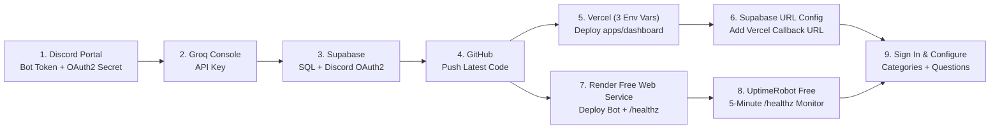

# Complete End-to-End Deployment Guide (Render Free + Vercel + Supabase + Groq + UptimeRobot)

This guide covers every step in exact order to deploy both the **Discord AI Ticket Assistant (`@hrbot/bot`)** on **Render Free** and the **Moderator Dashboard (`@hrbot/dashboard`)** on **Vercel Hobby**, with **only 3 required environment variables on Vercel**.

---

## Architecture & Free-Tier Stack



---

## Step 1: Discord Developer Portal (Bot + OAuth2 Redirect)

1. Go to https://discord.com/developers/applications and select your **AI Assistant** application (create a separate app for **Bot 2** — never reuse your existing Ticket Bot's token).
2. **General Information:**
   - Copy **Application ID** -> save as `DISCORD_CLIENT_ID`.
3. **OAuth2:**
   - Copy **Client Secret** (click *Reset Secret* if you haven't copied it yet) -> save for Supabase in Step 3.
   - *(Leave Redirects open — you will paste your Supabase callback URL here in Step 3.3!)*
4. **Bot:**
   - Copy **Token** (click *Reset Token* if needed) -> save as `DISCORD_BOT_TOKEN`.
   - Scroll down to **Privileged Gateway Intents**:
     - Turn **Message Content Intent** **ON**.
     - Keep *Presence Intent* and *Server Members Intent* **OFF** (saves RAM on Render Free).
   - Click **Save Changes**.
5. **Invite Bot to Your Server (Least-Privilege Only):**
   Open this URL in your browser (replace `YOUR_DISCORD_CLIENT_ID`):
   ```text
   https://discord.com/oauth2/authorize?client_id=YOUR_DISCORD_CLIENT_ID&scope=bot&permissions=274877991936
   ```
   - Make sure your existing Ticket Bot grants the AI Assistant's **Bot Role** `View Channel`, `Send Messages`, `Embed Links`, `Read Message History`, and `Send Messages in Threads` on your ticket categories and staff report channel.
6. **Copy Your Discord IDs** (enable *User Settings -> Advanced -> Developer Mode* in Discord):
   - Right-click your **Server icon** -> *Copy Server ID* -> `DISCORD_GUILD_ID`
   - Right-click **your own profile** -> *Copy User ID* -> `YOUR_DISCORD_USER_ID`

---

## Step 2: Groq API Key

1. Go to https://console.groq.com/keys and click **Create API Key**.
2. Copy the key (`gsk_...`) -> save as `GROQ_API_KEY`.

---

## Step 3: Supabase Database & Discord Login Setup

### 3.1 Copy Your 3 Supabase Credentials
In https://supabase.com/dashboard, open your project -> **Project Settings -> API** (or **API Keys**) and copy:
1. **Project URL** (`https://<project-ref>.supabase.co`) -> `SUPABASE_URL`
2. **`anon` `public` key** (or **Publishable key**) -> `SUPABASE_ANON_KEY`
3. **`service_role` `secret` key** (or **Secret key**) -> `SUPABASE_SECRET_KEY`

### 3.2 Run SQL Migrations & Authorize Your Discord Account
Open **SQL Editor -> New Query** in Supabase and run these **in order**:

1. Paste all of `supabase/migrations/0001_initial_schema.sql` -> click **Run**.
2. Paste all of `supabase/migrations/0002_rls_and_cleanup.sql` -> click **Run**.
3. Run this query (replace `YOUR_DISCORD_GUILD_ID` with your 18-digit Server ID and `YOUR_DISCORD_USER_ID` with your personal 18-digit Discord User ID):
   ```sql
   INSERT INTO public.server_settings (guild_id, guild_name)
   VALUES ('YOUR_DISCORD_GUILD_ID', 'My Discord Server')
   ON CONFLICT (guild_id) DO NOTHING;

   INSERT INTO public.dashboard_admins (guild_id, discord_user_id, label, permission_level)
   VALUES ('YOUR_DISCORD_GUILD_ID', 'YOUR_DISCORD_USER_ID', 'Owner', 'owner');
   ```

### 3.3 Enable Discord OAuth2 in Supabase (CRITICAL FOR WEBSITE LOGIN!)
1. In Supabase, go to **Authentication -> Providers -> Discord**.
2. Toggle **Enable Sign in with Discord** **ON**.
3. Paste:
   - **Client ID:** Your `DISCORD_CLIENT_ID` from Step 1.2
   - **Client Secret:** Your Discord OAuth2 **Client Secret** from Step 1.3
4. Copy the **Callback URL (for OAuth)** shown by Supabase:
   ```text
   https://<your-project-ref>.supabase.co/auth/v1/callback
   ```
5. Click **Save** in Supabase.
6. Go back to **Discord Developer Portal -> Your App -> OAuth2 -> Redirects**:
   - Click **Add Redirect** and paste **`https://<your-project-ref>.supabase.co/auth/v1/callback`** *(Note: Discord redirects to **Supabase**, NOT directly to Vercel!)*
   - Click **Save Changes**.

---

## Step 4: Push Latest Code to GitHub

Push all latest fixes (the server-side Discord OAuth fix + Render `pnpm` build fix) to `main`:

```powershell
git add .
git commit -m "Fix dashboard Discord OAuth2 login, simplify Vercel env vars, and fix Render pnpm build"
git push
```

---

## Step 5: Deploy Website Dashboard on Vercel (Only 3 Env Variables!)

1. Go to https://vercel.com/new (or open your existing Vercel project -> **Settings**).
2. Confirm **General -> Root Directory** is set to:
   ```text
   apps/dashboard
   ```
3. Go to **Settings -> Environment Variables** — you **only need these 3 variables** (you can delete any extra ones you don't need, though keeping `NEXT_PUBLIC_SUPABASE_URL` / `DEFAULT_GUILD_ID` won't hurt):

   | Variable Name | Value |
   |---|---|
   | `SUPABASE_URL` | `https://<your-project-ref>.supabase.co` |
   | `SUPABASE_ANON_KEY` | Your Supabase `anon` / `publishable` key |
   | `SUPABASE_SECRET_KEY` | Your Supabase `service_role` / `secret` key |

   *(Optional — only needed in special cases:)*
   - `DISCORD_GUILD_ID`: Only needed if you host multiple Discord servers in one database (otherwise auto-detected from `server_settings`!).
   - `GROQ_API_KEY`: Optional; the dashboard already has a built-in Groq model catalog without needing the key on Vercel.
   - `DASHBOARD_DISCORD_BOT_TOKEN`: Only needed if you allowlist Discord Role IDs instead of Discord User IDs.

4. Trigger a **Redeploy** on Vercel (**Deployments -> Redeploy**) so the latest login code goes live, and copy your Vercel URL (e.g. `https://your-dashboard.vercel.app`).

---

## Step 6: Connect Your Vercel URL in Supabase Auth (CRITICAL FOR WEBSITE LOGIN!)

1. In Supabase, go to **Authentication -> URL Configuration**.
2. Set **Site URL** to your exact Vercel URL (no trailing slash):
   ```text
   https://your-dashboard.vercel.app
   ```
3. Under **Redirect URLs**, click **Add URL** and add:
   ```text
   https://your-dashboard.vercel.app/auth/callback
   ```
   *(Optional: also add `https://*-your-vercel-team.vercel.app/auth/callback` or `http://localhost:3000/auth/callback` if testing previews/locally.)*
4. Click **Save**.

Now visit `https://your-dashboard.vercel.app/login` and click **Sign in with Discord** — it will redirect through Discord -> Supabase -> `/auth/callback` -> your Dashboard!
*(If your Discord User ID wasn't in `dashboard_admins` yet, the login page will now display your exact Discord User ID and give you the exact 2-line SQL to copy-paste into Supabase!)*

---

## Step 7: Deploy Discord AI Bot on Render Free Web Service

1. Go to https://dashboard.render.com/ -> create **one** **Web Service** (via **New + -> Blueprint** or **New + -> Web Service** connected to your GitHub repo).
2. Verify **Settings -> Build & Deploy**:
   - **Runtime:** `Node`
   - **Branch:** `main`
   - **Root Directory:** *(leave blank)*
   - **Instance Type:** `Free`
   - **Build Command:**
     ```bash
     COREPACK_ENABLE_DOWNLOAD_PROMPT=0 pnpm install --frozen-lockfile --prod=false --filter . --filter @hrbot/shared --filter @hrbot/bot && pnpm run build:bot
     ```
   - **Start Command:**
     ```bash
     pnpm --filter @hrbot/bot start
     ```
   - **Health Check Path:**
     ```text
     /healthz
     ```
3. Under **Environment**, add these variables:

   | Key | Value |
   |---|---|
   | `DISCORD_BOT_TOKEN` | Your Discord Bot Token (Step 1.4) |
   | `DISCORD_CLIENT_ID` | Your Discord Application ID (Step 1.2) |
   | `DISCORD_GUILD_ID` | Your 18-digit Discord Server ID (Step 1.6) |
   | `GROQ_API_KEY` | `gsk_...` (Step 2) |
   | `GROQ_MODEL` | `openai/gpt-oss-20b` |
   | `SUPABASE_URL` | `https://<your-project-ref>.supabase.co` |
   | `SUPABASE_SECRET_KEY` | Your Supabase `service_role` / `secret` key |
   | `NODE_ENV` | `production` |
   | `COREPACK_ENABLE_DOWNLOAD_PROMPT` | `0` |
   | `LOG_LEVEL` | `info` |

   *(Do **not** set `PORT` manually — Render injects `PORT` automatically.)*

4. Click **Manual Deploy -> Deploy latest commit**.
5. Once Render shows **Live**, test your public Render URL (`https://YOUR-RENDER-SERVICE.onrender.com`):
   - Open `https://YOUR-RENDER-SERVICE.onrender.com/healthz` -> returns `{"status":"ok"}` (`HTTP 200`).
   - Open `https://YOUR-RENDER-SERVICE.onrender.com/readyz` -> returns `{"status":"ready","discordConnected":true}` (`HTTP 200`).

---

## Step 8: Keep Render Awake with UptimeRobot Free

1. Sign up free at https://uptimerobot.com/ and click **+ Add New Monitor**:
   - **Monitor Type:** `HTTP(s)`
   - **Friendly Name:** `Discord AI Bot Keep Alive`
   - **URL:** `https://YOUR-RENDER-SERVICE.onrender.com/healthz`
   - **Monitoring Interval:** `5 minutes`
   - **Expected Status:** `HTTP 200`
2. Click **Create Monitor**.

---

## Step 9: Configure Categories & Questions in the Website Dashboard

1. Sign in at `https://your-dashboard.vercel.app/login`.
2. Confirm **Bot Worker Online** is green on **Overview**.
3. **AI Settings:** Paste your **Existing Ticket Bot's Discord User ID** under *Existing Ticket Provider Bot User IDs* (or turn *Require Ticket Provider Bot Verification* OFF while testing) -> click **Publish**.
4. **Report Settings:** Paste your existing **Staff Report Channel ID** -> click **Publish**.
5. **Category Management:** Add your existing Discord Ticket Category ID, toggle **Enable AI in Category** ON -> click **Publish Category Version**.
6. **Question Builder:** Add your intake questions and click **Publish Questionnaire**.

---

## Troubleshooting Website Login

| What You See on `/login` | Cause & Instant Fix |
|---|---|
| **`Discord OAuth2 Sign-In Failed: Invalid Redirect URI`** (on Discord screen) | In **Discord Developer Portal -> OAuth2 -> Redirects**, make sure you added **`https://<project-ref>.supabase.co/auth/v1/callback`** (Supabase's callback URL, *not* Vercel's URL). |
| **`Error getting user email from external provider`** | Fixed in code (`scopes: 'identify email'`). Also ensure your Discord account has a verified email address. |
| **`Discord login succeeded as User ID ..., but your account is not yet in dashboard_admins`** | Copy the pre-filled 2-line `INSERT INTO public.dashboard_admins ...` SQL box shown right on the `/login` screen and run it in **Supabase -> SQL Editor**. |
| **`Missing Dashboard Environment Variables`** | Check **Vercel -> Settings -> Environment Variables** and make sure `SUPABASE_URL`, `SUPABASE_ANON_KEY`, and `SUPABASE_SECRET_KEY` are saved for **Production**, then click **Redeploy**. |
